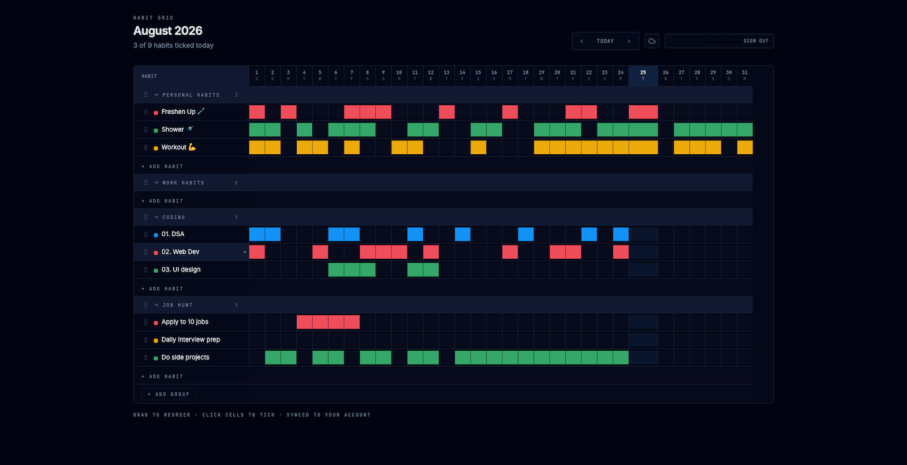

<div align="center">

# HabitsGrid

### Build better habits, one cell at a time.

A modern habit tracking app with a clean visual grid, 10 color themes, drag-and-drop reordering, and optional cloud sync.

[**Live Demo**](https://habitsgrid.pro) · [Report Bug](https://github.com/coder-wolf/habitsgrid.pro/issues) · [Request Feature](https://github.com/coder-wolf/habitsgrid.pro/issues)

<br/>



<br/>

[](https://react.dev)
[](https://typescriptlang.org)
[](https://tailwindcss.com)
[](https://tanstack.com/start)
[](https://supabase.com)

</div>

---

## What is HabitsGrid?

HabitsGrid is a spreadsheet-style habit tracker that makes consistency visual. Mark off cells, watch your streaks grow, and build lasting routines — all in a clean, distraction-free interface.

**Free tier** stores everything locally in your browser. **Pro tier** unlocks cloud sync so your habits follow you across devices.

---

## Features

| | Feature | Details |
|---|---|---|
| | **Visual Grid** | Monthly calendar view — tap cells to mark habits complete |
| | **Drag & Drop** | Reorder habits and sections with smooth animations |
| | **10 Themes** | Light, Midnight, Sunset, Forest, Lavender, Pink, Indigo, Teal, Charcoal, Cocoa |
| | **Cloud Sync** | Pro users: habit data synced to Supabase with debounced upserts |
| | **Subscription Billing** | LemonSqueezy-powered checkout, webhooks, and plan management |
| | **Responsive** | Works on desktop and mobile with adaptive layouts |
| | **Onboarding** | Guided 2-step flow: sign in, then optionally upgrade to Pro |
| | **Analytics** | Built-in charts to visualize your consistency over time |

---

## Tech Stack

| Layer | Technology | Purpose |
|---|---|---|
| **Framework** | [TanStack Start](https://tanstack.com/start) | SSR, file-based routing, server functions |
| **UI** | [React 19](https://react.dev) · [shadcn/ui](https://ui.shadcn.com) · [Radix UI](https://www.radix-ui.com) | 46 accessible components |
| **Styling** | [Tailwind CSS 4](https://tailwindcss.com) | oklch color themes, utility-first CSS |
| **State** | React Context · [TanStack React Query](https://tanstack.com/query) | Local + server state management |
| **Database** | [Supabase](https://supabase.com) | PostgreSQL, Auth, Row Level Security |
| **Payments** | [LemonSqueezy](https://www.lemonsqueezy.com) | Checkout sessions, subscriptions, webhooks |
| **Forms** | [React Hook Form](https://react-hook-form.com) · [Zod](https://zod.dev) | Type-safe form validation |
| **Charts** | [Recharts](https://recharts.org) | Consistency visualizations |
| **Build** | [Vite 8](https://vitejs.dev) · Rolldown | Rust-powered bundler |
| **Deploy** | [Vercel](https://vercel.com) | Edge functions, automatic deploys |
| **Analytics** | [Vercel Analytics](https://vercel.com/analytics) | Privacy-first tracking |

---

## Getting Started

### Prerequisites

- [Node.js](https://nodejs.org/) 18+
- [Bun](https://bun.sh/) (recommended) or npm
- A [Supabase](https://supabase.com/) project
- A [LemonSqueezy](https://www.lemonsqueezy.com/) account

### 1. Clone & install

```sh
git clone https://github.com/coder-wolf/habitsgrid.pro.git
cd habitsgrid.pro
bun install
```

### 2. Configure environment

```sh
cp .env.example .env
```

| Variable | Where to find it |
|---|---|
| `VITE_SUPABASE_URL` | Supabase Dashboard → Settings → API |
| `VITE_SUPABASE_PUBLISHABLE_KEY` | Supabase Dashboard → Settings → API |
| `LEMONSQUEEZY_API_KEY` | LemonSqueezy → Settings → API |
| `LEMONSQUEEZY_STORE_ID` | LemonSqueezy → Settings → API |
| `LEMONSQUEEZY_WEBHOOK_SECRET` | LemonSqueezy → Settings → Webhooks |
| `LEMONSQUEEZY_PRODUCT_ID` | LemonSqueezy → Products |
| `LEMONSQUEEZY_VARIANT_ID` | LemonSqueezy → Products → Variants |

### 3. Run database migrations

Apply the SQL files in `supabase/migrations/` via the Supabase SQL Editor or CLI.

### 4. Start developing

```sh
bun run dev
```

Open [http://localhost:3000](http://localhost:3000).

---

## Scripts

| Command | Description |
|---|---|
| `bun run dev` | Start development server |
| `bun run build` | Production build |
| `bun run build:dev` | Development build |
| `bun run preview` | Preview production build |
| `bun run lint` | Run ESLint |
| `bun run format` | Format code with Prettier |

---

## Project Structure

```
src/
├── components/
│   ├── ui/                    46 shadcn/ui components
│   ├── auth-dialog.tsx        Sign-in dialog (Google OAuth)
│   ├── navbar.tsx             Navigation with month controls
│   ├── onboarding-flow.tsx    2-step onboarding (sign in + upgrade)
│   ├── theme-switcher.tsx     10-theme color picker
│   ├── upgrade-dialog.tsx     Pro upgrade modal
│   └── datafast.tsx           Analytics provider
├── hooks/
│   └── use-mobile.tsx         Mobile breakpoint detection
├── lib/
│   ├── auth.tsx               Auth context (Supabase + Google OAuth)
│   ├── supabase.ts            Supabase client init
│   ├── theme.tsx              Theme context (10 themes)
│   ├── habits.ts              Habit data types and helpers
│   ├── checkout.ts            Server fn: create checkout session
│   ├── webhook.ts             Server fn: LemonSqueezy webhook
│   ├── cancel-subscription.ts Server fn: cancel subscription
│   ├── subscription-server.ts Server fn: fetch subscription
│   ├── sync-subscription.ts   Server fn: sync from LemonSqueezy API
│   └── utils.ts               cn() utility (clsx + tailwind-merge)
├── routes/
│   ├── __root.tsx             Root layout (providers, meta, analytics)
│   ├── index.tsx              Main habit grid
│   ├── onboarding.tsx         Onboarding route
│   ├── settings/billing.tsx   Billing management
│   └── api/webhooks/lemonsqueezy.ts  Webhook endpoint
├── styles.css                 Tailwind + 10 oklch themes
├── server.ts                  SSR error recovery wrapper
└── start.ts                   TanStack Start middleware (CSRF + errors)
```

---

## Database Schema

### `subscriptions`

Tracks LemonSqueezy subscription data, linked to Supabase `auth.users`.

| Column | Type | Description |
|---|---|---|
| `id` | UUID | Primary key |
| `user_id` | UUID | FK to `auth.users(id)` — unique index |
| `email` | TEXT | Subscriber email |
| `lemon_squeezy_id` | TEXT | LemonSqueezy subscription ID |
| `status` | TEXT | `active` · `cancelled` · `expired` · `inactive` · `pending` |
| `plan_id` | TEXT | Product ID |
| `variant_id` | TEXT | Variant ID |
| `renews_at` | TIMESTAMPTZ | Next renewal date |
| `expires_at` | TIMESTAMPTZ | Expiration date |
| `created_at` | TIMESTAMPTZ | Row creation |
| `updated_at` | TIMESTAMPTZ | Auto-updated via trigger |

**Row Level Security:** Users can only read their own subscription. Service role (webhooks) has full access.

### `user_state`

Stores per-user habit grid data as a JSON blob. Used by Pro users for cloud sync.

---

## Architecture

| Pattern | How it works |
|---|---|
| **Dual Storage** | Free: `localStorage` · Pro: Supabase with debounced upserts |
| **Server Functions** | TanStack Start `createServerFn()` with CSRF protection |
| **SSR Error Recovery** | Custom wrapper catches unhandled errors, renders fallback HTML |
| **Supply Chain Guard** | Bun `minimumReleaseAge = 86400` (24h) prevents supply chain attacks |
| **Freemium Model** | Free tier (localStorage) vs Pro tier (cloud sync + subscription) |

---

## Deployment

The app is deployed to **Vercel** at [habitsgrid.pro](https://habitsgrid.pro).

```sh
vercel --prod
```

---

## License

Private — not for redistribution.
